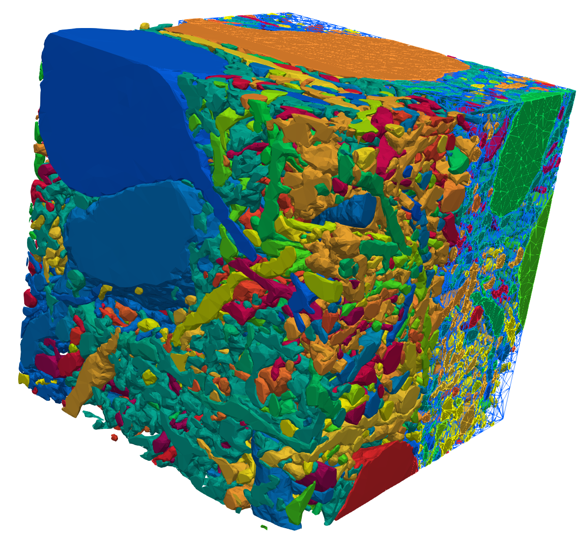
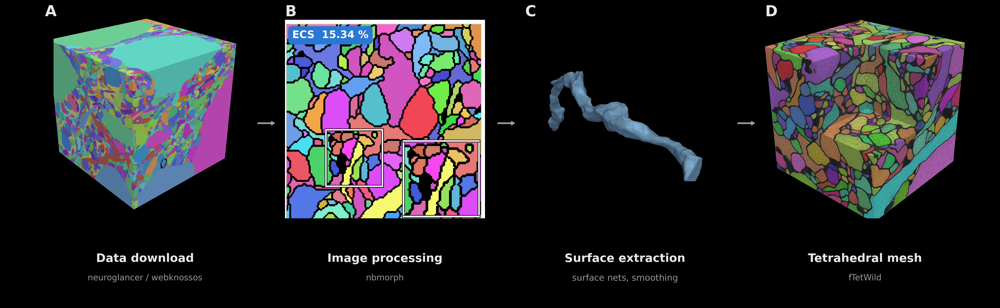
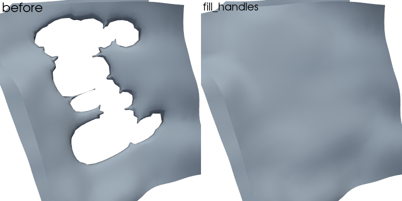
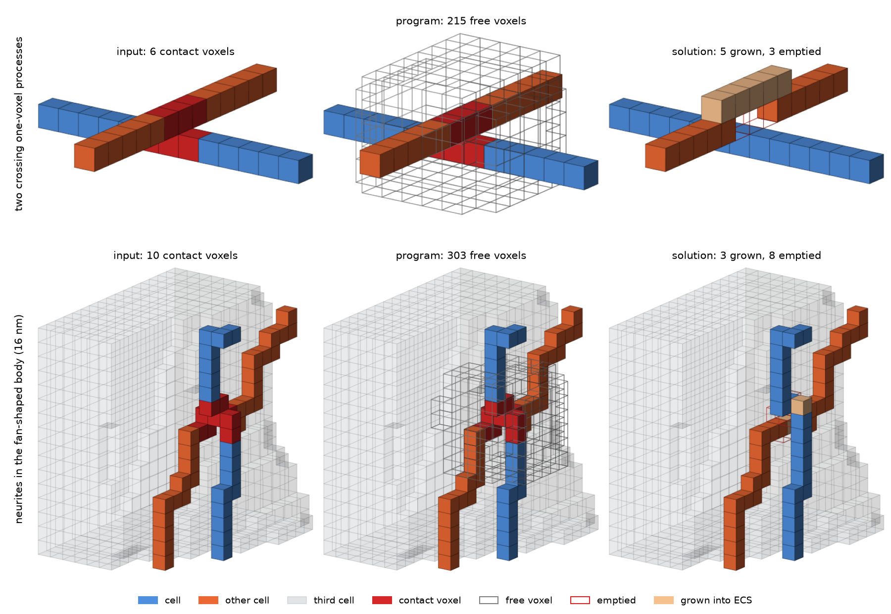
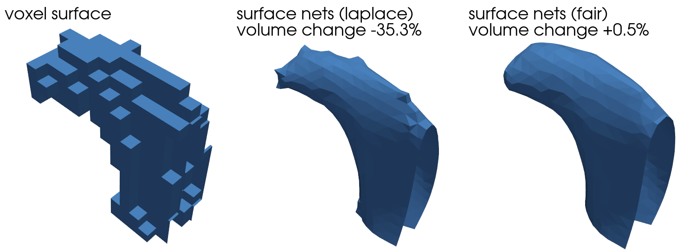
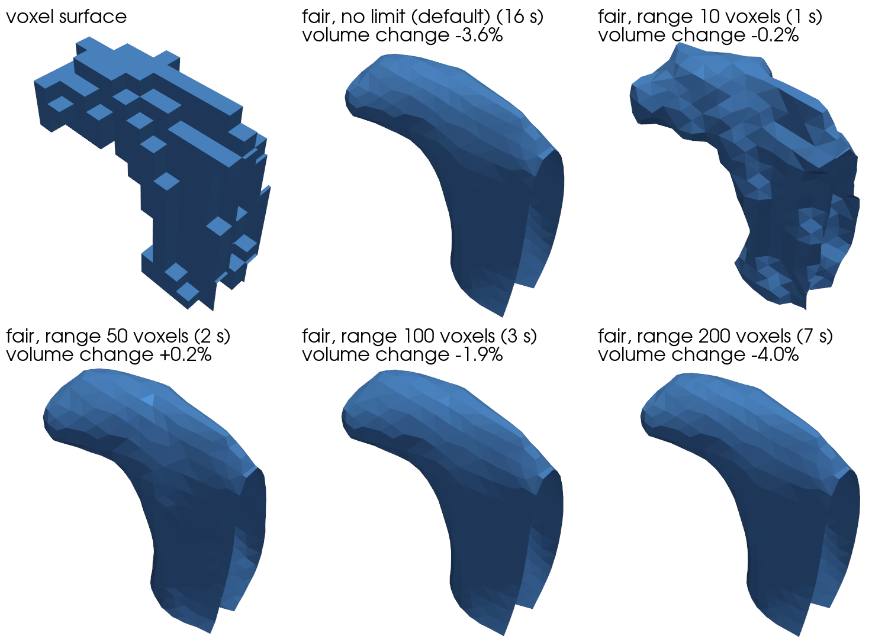
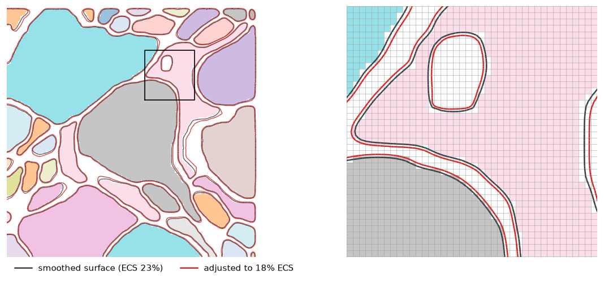
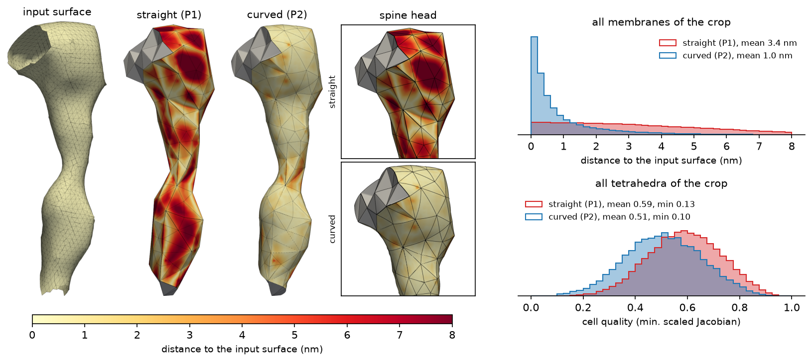

# EMI-Mesh: Generating high-quality extracellular-membrane-intracellular meshes from imaging data




EMI-Mesh generates tetrahedral meshes of brain tissue at the cellular scale, including the extracellular space (ECS), from segmented electron microscopy data. The meshes are suitable for numerical simulations.

## Getting started

Install snakemake (using conda):

```
conda create -c conda-forge -c bioconda -n snakemake snakemake snakemake-storage-plugin-http snakemake-executor-plugin-cluster-generic
conda activate snakemake
```

Then run the pipeline on an example configuration:

```
snakemake --configfile config_files/cortical_mm3.yml --use-conda --cores 8
```

## Pipeline



- **A. Data download** of the segmentation (cloud-volume or webknossos). Take a look at the [microns explorer gallery](https://www.microns-explorer.org/gallery-mm3), and copy cloudpath and position from the interactive neuroglancer view.
- **B. Image processing:** resampling and a sequence of morphological [operations](#image-processing-operations) on the labels. These set the rough ECS share, separate the cells and repair topology.
- **C. Surface extraction:** one multi-label surface of all cells and the ECS, made with surface nets and smoothed (Laplacian smoothing or [fairing](#surface-smoothing)). Optionally, the [ECS share](#ecs-share) is fine-tuned on the surface.
- **D. Tetrahedral mesh:** the surface is simplified and tetrahedralized with [fTetWild](https://github.com/wildmeshing/fTetWild). Optionally, the mesh is [curved](#curved-meshes).

## Configuration

A configuration file has the sections `raw`, `processing`, `surface` (optional) and `meshing`. For example:

```yaml
name : cortical_mm3            # name of the output folder
raw:
  cloudpath : "precomputed://gs://iarpa_microns/minnie/minnie65/seg"
  mip : 2                      # resolution level (0 = finest)
  position : "225182-107314-22000"   # center, in neuroglancer voxels
  position_resolution : "4-4-40"     # their size in nm (default: MICrONS explorer)
  size : 5000                  # side length in nm, or "x-y-z"
processing:
  dx : 20                      # isotropic voxel size (nm) for resampling
  operation :
    - "smooth iterations=1 radius=1"
    - "erode radius=1"
meshing:
  envelopsize : 18             # max. deviation of the mesh from the surface (nm)
```

| Section | Option | Description |
| :--- | :--- | :--- |
| `processing` | **`ncells`** | Keep only the `N` largest cells. |
| `surface` | **`method`** | `laplace` (default) or `fair`; see [below](#surface-smoothing). |
| | **`smoothing_scale`** | `laplace`: maximal displacement of the surface points, in voxels (default: 1.2). |
| | **`smoothing_iterations`** | Number of smoothing iterations (default: 16 for `laplace`; 100 for `fair`, or as many as `influence_radius` allows). |
| | **`influence_radius`** | `fair`: range of influence in voxels: no surface point depends on a voxel further away (default: no limit); see [below](#surface-smoothing). |
| | **`max_distance`** | `fair`: maximal distance from the voxel surface, in voxels (default: 1). |
| | **`dead_zone`** | `fair`: free motion along the normal, in voxels (default: 0.5). |
| | **`alpha`** | `fair`: smoothness weight (default: 30). |
| | **`volume`** | `fair`: keep the volume of every cell (default: `true`). |
| | **`ecs_share`** | Target ECS volume share (0–1); see [below](#ecs-share). |
| | **`ecs_min_width`** | Minimal thickness of cells and ECS gaps (nm) during the ECS adjustment (default: 10). |
| `meshing` | **`stopquality`** | fTetWild quality score (default: 10). Higher values stop earlier, giving lower quality. |
| | **`simplify_eps`** | Maximal deviation of the simplified surface (nm, default: 0.5 voxels). `0` disables simplification. |
| | **`edge_length_fac`** | fTetWild target edge length, relative to the bounding box diagonal (default: 0.05). |
| | **`curved`** | `true` for [curved](#curved-meshes) 10-node tetrahedra (default: `false`). |

## Image processing operations

Operations are listed under `processing: operation` as strings of the form `"command arg1=value1 ..."` and are applied in order. They are based on [nbmorph](https://github.com/MariusCausemann/nbmorph) and are multithreaded. Any `labels` argument refers to the cell IDs of the original segmentation.

| Operation | Arguments | Description |
| :--- | :--- | :--- |
| **`merge`** | `labels` | Merge all labels into the first one. |
| **`ncells`** | `ncells`, `keep_cell_labels` | Keep the `N` largest cells, plus the listed ones. |
| **`dilate`** / **`erode`** | `radius`, `labels` | Grow or shrink all cells, or only the listed ones. `erode` also takes `struct_sequence` (default: `B` for `radius=1`, `DDB` otherwise). |
| **`smooth`** | `radius`, `iterations`, `labels` | Morphological opening and closing. |
| **`removeislands`** | `minsize` | Remove components smaller than `minsize` voxels. |
| **`prune_tips`** | `iterations` | Remove voxels with at most one face neighbour of the same cell (one-voxel spikes). One pass by default; `iterations=None` repeats until none is left. |
| **`reconnect`** | `s`, `t` | Join the cuts that the operations before it (since the start or the last `reconnect`) made through a cell, up to the length scale `s` (voxels, default 20): a cut is found within a tile of 3`s` voxels, and the cheapest path through the cell's original voxels is restored, thickened by `t` (default 2). Small loops (below about `s`) that an operation cut stay cut. Works on a window of a larger image (same grid, margin about 2.5`s`). |
| **`remove_pinches`** | `separate_cells` | Repair edge and corner contacts between voxels of the same cell (and of the ECS), so that surface nets gives a manifold surface. A contact is separated where a voxel can be taken without splitting a cell; otherwise a cell grows (preferably not next to another cell) or a voxel is exchanged between cells. Never splits a cell. |
| **`separate_labels`** | `side`, `connectivity`, `avoid_pinches`, `erode_background`, `detour` | Separate touching cells by ECS where that keeps every cell's topology (nbmorph); contacts where no voxel can be removed are kept. Works on a window of a larger image. |
| **`separate_cells`** | `workers`, `cell`, `max_rounds` | Remove the remaining contacts between cells (26-neighbourhood) without cutting off, deleting or disconnecting any piece of a cell and without creating pinches, changing as few voxels as possible per contact site (see below). Works on a window of a larger image. |
| **`fill_handles`** | `thickness`, `max_loop_length`, `workers` | Close handles (tunnels) of cells with thin membranes. |
| **`roigenerate`** / **`roiapply`** | `labels` | Create a mask from the listed cells, and later set everything outside it to 0. |
| **`roi<op>`** | as `<op>` | Apply an operation to the mask, e.g. `roidilate radius=80`. |

See `config_files/` for complete examples, e.g. `cappilary1.yml` for an ROI around a capillary.

### Handles
`fill_handles` closes handles (tunnels) through a cell with a thin membrane, spanned along the shortest loop around each tunnel:




### Separating cells
`separate_labels` (nbmorph) removes most contacts between cells quickly, but only where a voxel can be emptied without changing its cell's topology. `separate_cells` removes the rest: it solves every remaining contact site as a small 0/1 program ([HiGHS](https://highs.dev)). In a box around the site, the voxels within 2 of a contact are free, and each one keeps its cell or becomes ECS; ECS voxels next to a cell may join it. The constraints forbid contacts and pinches and keep every piece of a cell connected; the objective is the number of changed voxels. Below (`python images/plot_separation.py images/separation.png`), two one-voxel processes cross: emptying either contact voxel would cut a process, so cell 2 is routed over cell 1. In the second row, two neurites of the fan-shaped body (FlyEM male CNS, 16 nm voxels, processed as in the script) still touch after `separate_labels`; they are separated with 11 voxels changed. Sites are taken on a lattice fixed in whole-image coordinates, so a block with a halo gets the same result as the whole image; `workers` solves independent sites in parallel.



### Surface smoothing
The surface nets have their points on the voxel corners. `surface: method` selects how they are smoothed:

- `laplace` (default): constrained Laplacian smoothing; each point moves at most `smoothing_scale` voxels. It shrinks thin processes, and points that reach the limit form spikes.
- `fair`: volume-preserving fairing. It minimizes the squared Laplacian of the surface, lets points move freely along the normal within `dead_zone` voxels, and keeps every point within `max_distance` voxels of the voxel surface; the limit is enforced during the iterations, so it creates no spikes. A second pass restores the volume of every cell locally (the median cell changes by less than 0.1 %, small cells by a few percent). It is local: with `influence_radius: R`, no surface point depends on a voxel more than `R` voxels away (bitwise, independent of the number of threads), so a block cut out of the image gives the same surface as the whole image at points more than `R` voxels from the block's faces (if its voxel coordinates are the same numbers, e.g. integer nm). It takes about 15 s for 10⁶ faces without a limit, and 2–3 s with `influence_radius: 50`–`100`.

Below, a close-up of a cell from a 2 µm cube of the FlyEM male CNS (16 nm voxels, `python images/plot_fairing.py images/fairing.png`), with the volume change of the whole cell. The Laplacian smoothing shrinks the cell by 35 % and leaves spikes; the fairing keeps most of its volume (−3.6 % for this small cell) and has no spikes.



```yaml
surface:
  method: fair
  max_distance: 1        # voxels
  influence_radius: 100  # voxels (optional; default: no limit)
```

The same cell faired with different ranges of influence (`python images/plot_fairing_range.py images/fairing_range.png`). Ten voxels leave room for only a few steps; from 50 voxels on, the surface is close to the unlimited one.



### ECS share
With `surface: ecs_share`, all cell–ECS interfaces are moved by a common offset until the ECS takes that share of the volume. The bounding box is kept, and cells and gaps stay at least `ecs_min_width` thick. Below, the ECS share of a dense crop is lowered from 23 % to 18 % (right: zoomed region, with the voxel grid).



This adjustment is limited in range: Set the rough ECS share with the voxel operations (e.g. `erode`, `dilate`), and use `ecs_share` to fine-tune it.

### Curved meshes
fTetWild meshes the simplified surface with straight-sided tetrahedra, which cut the corners of curved membranes. With `meshing: curved: true`, the mesh is converted to quadratic (10-node) tetrahedra, and the nodes on the membranes and on the boundary are moved onto the input surface of the mesh step (the fine surface before simplification), onto the part with the same two labels. Nodes move step by step, and a step that would push a cell below half its initial quality, or below 0.1 (whichever is higher, but at most the initial quality), is shortened or skipped, so no cell is inverted. The number of cells is unchanged.

The figure shows a dendritic spine from an 800 nm crop (20 nm voxels): its input surface, and the straight and curved meshes colored by the distance to it, with whole tetrahedra (gray) at the crop box. Over all membranes of the crop, curving reduces the mean distance from 3.4 nm to 1.0 nm, and the 95th percentile from 7.8 nm to 3.6 nm. The mean volume error of the cells drops from 7.5 % to 1.9 % (max. 15 % to 6 %). A few nodes cannot reach the surface without inverting a cell, some larger distances remain. Curving costs some cell quality: the mean minimal scaled Jacobian decreases from 0.59 to 0.51, and the minimum from 0.13 to 0.10.



## Python API
The pipeline steps can also be called from Python:

```python
import pyvista as pv
from imagemesh.image import np2pv
from imagemesh.tetmesh import mesh_surface

from emimesh.clients.generate_mesh import curve_mesh
from emimesh.download_data import download_cloudvolume
from emimesh.ecs_share import adjust_ecs_share
from emimesh.extract_surfaces import extract_surface
from emimesh.process_image_data import process_image

# a 2 µm cube of the MICrONS segmentation (position in voxels, size in nm)
url = "precomputed://gs://iarpa_microns/minnie/minnie65/seg_m1300"
img, res = download_cloudvolume(url, mip=1, pos=[162258, 200928, 20530], physical_size=[2000] * 3)
raw = np2pv(img, res)

ops = [
    ["smooth", "iterations=1", "radius=2"],
    ["erode", "radius=1"],
    ["removeislands", "minsize=150"],  # fragments too small to mesh
]
img, *_ = process_image(raw, dx=20, operations=ops)  # cells get the labels 2, 3, ...
surf = extract_surface(img)  # multi-label surface, ECS = 1; method="fair" for fairing
surf, _, share = adjust_ecs_share(surf, 0.3)  # optional, takes a few minutes
mesh, _ = mesh_surface(surf, envelopsize=8, simplify_eps=3)
mesh = curve_mesh(mesh, surf)  # optional: curved 10-node tetrahedra
pv.save_meshio("mesh.xdmf", mesh)
```

## Output
Results are written to `results/<name>/`:
* `raw/`, `processed/`: the downloaded and the processed label image (`.vti`). `processed/imagestatistic.yml` maps the mesh labels to the original cell IDs.
* `surfaces/`: the multi-label surfaces (`.vtk`), with the labels on both sides of each face in `boundary_labels`. These are `surf_smooth.vtk`, `surf_ecs.vtk` (only with `ecs_share`) and `surf_dec.vtk` (simplified, the input of fTetWild).
* `meshes/`: the tetrahedral mesh (`mesh.xdmf`) with cell data `label` (1 = ECS, 2…N = cells), plus mesh statistics and a screenshot. With `curved: true`, the mesh has quadratic tetrahedra (`tetra10`), and the volumes and areas in the statistics are integrated over the curved cells.
