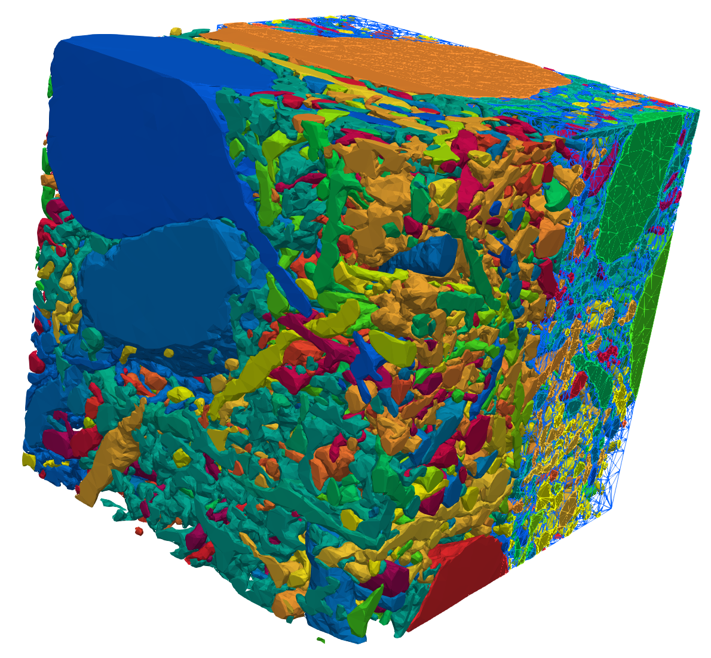
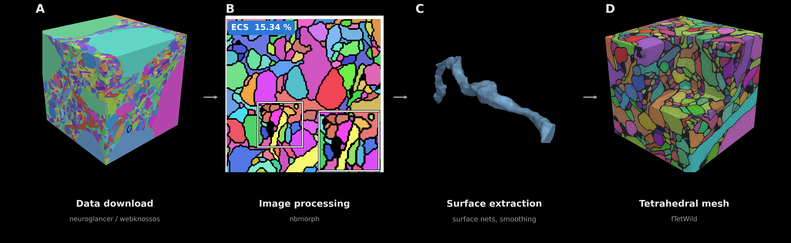
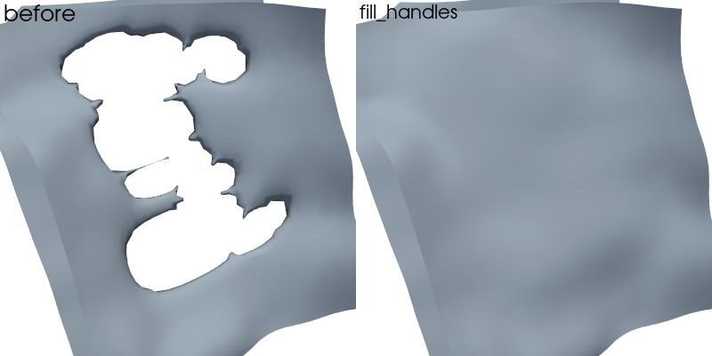
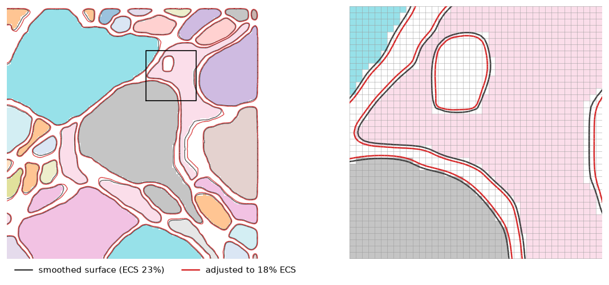
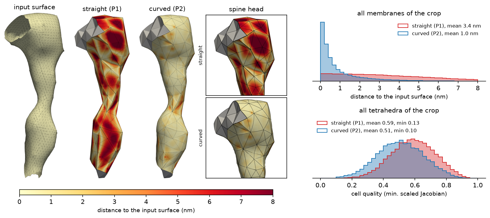

# EMI-Mesh: Generating high-quality extracellular-membrane-intracellular meshes from imaging data




EMI-Mesh generates tetrahedral meshes of brain tissue at the cellular scale, including the extracellular space (ECS), from segmented electron microscopy data. The meshes are suitable for numerical simulations.

## Getting started

Install snakemake (using conda):

```
conda create -c conda-forge -c bioconda -n snakemake snakemake snakemake-storage-plugin-http snakemake-executor-plugin-cluster-generic
conda activate snakemake
```

Then run the pipeline on an example configuration:

```
snakemake --configfile config_files/cortical_mm3.yml --use-conda --cores 8
```

## Pipeline



- **A. Data download** of the segmentation (cloud-volume or webknossos). Take a look at the [microns explorer gallery](https://www.microns-explorer.org/gallery-mm3), and copy cloudpath and position from the interactive neuroglancer view.
- **B. Image processing:** resampling and a sequence of morphological [operations](#image-processing-operations) on the labels. These set the rough ECS share, separate the cells and repair topology.
- **C. Surface extraction:** one multi-label surface of all cells and the ECS, made with surface nets and smoothed. Optionally, the [ECS share](#ecs-share) is fine-tuned on the surface.
- **D. Tetrahedral mesh:** the surface is simplified and tetrahedralized with [fTetWild](https://github.com/wildmeshing/fTetWild). Optionally, the mesh is [curved](#curved-meshes).

## Configuration

A configuration file has the sections `raw`, `processing`, `surface` (optional) and `meshing`. For example:

```yaml
name : cortical_mm3            # name of the output folder
raw:
  cloudpath : "precomputed://gs://iarpa_microns/minnie/minnie65/seg"
  mip : 2                      # resolution level (0 = finest)
  position : "225182-107314-22000"   # center, in voxels of the dataset
  size : 5000                  # side length in nm, or "x-y-z"
processing:
  dx : 20                      # isotropic voxel size (nm) for resampling
  operation :
    - "smooth iterations=1 radius=1"
    - "erode radius=1"
meshing:
  envelopsize : 18             # max. deviation of the mesh from the surface (nm)
```

| Section | Option | Description |
| :--- | :--- | :--- |
| `processing` | **`ncells`** | Keep only the `N` largest cells. |
| `surface` | **`smoothing_scale`** | Maximal displacement of the surface points during smoothing, in voxels (default: 1.2). |
| | **`smoothing_iterations`** | Number of smoothing iterations (default: 16). |
| | **`ecs_share`** | Target ECS volume share (0–1); see [below](#ecs-share). |
| | **`ecs_min_width`** | Minimal thickness of cells and ECS gaps (nm) during the ECS adjustment (default: 10). |
| `meshing` | **`stopquality`** | fTetWild quality score (default: 10). Higher values stop earlier, giving lower quality. |
| | **`simplify_eps`** | Maximal deviation of the simplified surface (nm, default: 0.5 voxels). `0` disables simplification. |
| | **`edge_length_fac`** | fTetWild target edge length, relative to the bounding box diagonal (default: 0.05). |
| | **`curved`** | `true` for [curved](#curved-meshes) 10-node tetrahedra (default: `false`). |

## Image processing operations

Operations are listed under `processing: operation` as strings of the form `"command arg1=value1 ..."` and are applied in order. They are based on [nbmorph](https://github.com/MariusCausemann/nbmorph) and are multithreaded. Any `labels` argument refers to the cell IDs of the original segmentation.

| Operation | Arguments | Description |
| :--- | :--- | :--- |
| **`merge`** | `labels` | Merge all labels into the first one. |
| **`ncells`** | `ncells`, `keep_cell_labels` | Keep the `N` largest cells, plus the listed ones. |
| **`dilate`** / **`erode`** | `radius`, `labels` | Grow or shrink all cells, or only the listed ones. `erode` also takes `struct_sequence` (default: `B` for `radius=1`, `DDB` otherwise). |
| **`smooth`** | `radius`, `iterations`, `labels` | Morphological opening and closing. |
| **`removeislands`** | `minsize` | Remove components smaller than `minsize` voxels. |
| **`fill_handles`** | `thickness`, `max_loop_length`, `workers` | Close handles (tunnels) of cells with thin membranes. |
| **`roigenerate`** / **`roiapply`** | `labels` | Create a mask from the listed cells, and later set everything outside it to 0. |
| **`roi<op>`** | as `<op>` | Apply an operation to the mask, e.g. `roidilate radius=80`. |

See `config_files/` for complete examples, e.g. `cappilary1.yml` for an ROI around a capillary.

### Handles
`fill_handles` closes handles (tunnels) through a cell with a thin membrane, spanned along the shortest loop around each tunnel:




### ECS share
With `surface: ecs_share`, all cell–ECS interfaces are moved by a common offset until the ECS takes that share of the volume. The bounding box is kept, and cells and gaps stay at least `ecs_min_width` thick. Below, the ECS share of a dense crop is lowered from 23 % to 18 % (right: zoomed region, with the voxel grid).



This adjustment is limited in range: Set the rough ECS share with the voxel operations (e.g. `erode`, `dilate`), and use `ecs_share` to fine-tune it.

### Curved meshes
fTetWild meshes the simplified surface with straight-sided tetrahedra, which cut the corners of curved membranes. With `meshing: curved: true`, the mesh is converted to quadratic (10-node) tetrahedra, and the nodes on the membranes and on the boundary are moved onto the input surface of the mesh step (the fine surface before simplification), onto the part with the same two labels. Nodes move step by step, and a step that would push a cell below half its initial quality, or below 0.1 (whichever is higher, but at most the initial quality), is shortened or skipped, so no cell is inverted. The number of cells is unchanged.

The figure shows a dendritic spine from an 800 nm crop (20 nm voxels): its input surface, and the straight and curved meshes colored by the distance to it, with whole tetrahedra (gray) at the crop box. Over all membranes of the crop, curving reduces the mean distance from 3.4 nm to 1.0 nm, and the 95th percentile from 7.8 nm to 3.6 nm. The mean volume error of the cells drops from 7.5 % to 1.9 % (max. 15 % to 6 %). A few nodes cannot reach the surface without inverting a cell, some larger distances remain. Curving costs some cell quality: the mean minimal scaled Jacobian decreases from 0.59 to 0.51, and the minimum from 0.13 to 0.10.



## Python API
The pipeline steps can also be called from Python:

```python
import pyvista as pv
from imagemesh.image import np2pv
from imagemesh.tetmesh import mesh_surface

from emimesh.clients.generate_mesh import curve_mesh
from emimesh.download_data import download_cloudvolume
from emimesh.ecs_share import adjust_ecs_share
from emimesh.extract_surfaces import extract_surface
from emimesh.process_image_data import process_image

# a 2 µm cube of the MICrONS segmentation (position in voxels, size in nm)
url = "precomputed://gs://iarpa_microns/minnie/minnie65/seg_m1300"
img, res = download_cloudvolume(url, mip=1, pos=[162258, 200928, 20530], physical_size=[2000] * 3)
raw = np2pv(img, res)

ops = [
    ["smooth", "iterations=1", "radius=1"],
    ["erode", "radius=1"],
    ["removeislands", "minsize=150"],  # fragments too small to mesh
]
img, *_ = process_image(raw, dx=20, operations=ops)  # cells get the labels 2, 3, ...
surf = extract_surface(img)  # multi-label surface, ECS = 1
surf, _, share = adjust_ecs_share(surf, 0.25)  # optional, takes a few minutes
mesh, _ = mesh_surface(surf, envelopsize=20, simplify_eps=10)
mesh = curve_mesh(mesh, surf)  # optional: curved 10-node tetrahedra
pv.save_meshio("mesh.xdmf", mesh)
```

## Output
Results are written to `results/<name>/`:
* `raw/`, `processed/`: the downloaded and the processed label image (`.vti`). `processed/imagestatistic.yml` maps the mesh labels to the original cell IDs.
* `surfaces/`: the multi-label surfaces (`.vtk`), with the labels on both sides of each face in `boundary_labels`. These are `surf_smooth.vtk`, `surf_ecs.vtk` (only with `ecs_share`) and `surf_dec.vtk` (simplified, the input of fTetWild).
* `meshes/`: the tetrahedral mesh (`mesh.xdmf`) with cell data `label` (1 = ECS, 2…N = cells), plus mesh statistics and a screenshot. With `curved: true`, the mesh has quadratic tetrahedra (`tetra10`), and the volumes and areas in the statistics are integrated over the curved cells.
